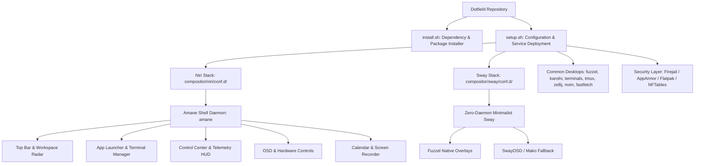

# Dotfield System Architecture

## 1. Executive Summary

**Dotfield** is a declarative, modular Linux ricing ecosystem and Wayland desktop suite designed for production stability, security sandboxing, and ultra-low overhead.

Rather than maintaining fragile compiler layers or monolithic configuration files, Dotfield organizes configurations into composable, drop-in modules (`conf.d/*.kdl`, `conf.d/*.conf`). It natively supports two distinct Wayland paradigms:

1. **Niri**: Powered by **Amane** (`amane`), a high-performance native desktop shell written in Rust with Vulkan/Vello GPU rendering.
2. **Sway**: A lean, distraction-free environment utilizing native `fuzzel` menus, suppressed status bars, and zero daemon overhead.

---

## 2. Core Subsystems

### 2.1 `amane` (Desktop Shell for Niri)
- **Role**: High-performance native Wayland desktop shell (`crates/amane-shell`, binary: `amane`) built exclusively for **Niri**.
- **Rendering**: Pure Rust + Vulkan with Vello 2D GPU rendering. Zero WebKit, Electron, or Slint bloat.
- **Memory Footprint**: Steady state ~58–60 MB RAM.
- **Supervisor**: Supervised under systemd user manager (`amane.service`) with auto-recreation across output DPMS/re-negotiation events and auto-healing CLI IPC.
- **Integrated Capabilities**:
  - Full-width Top Status Bar with dynamic multi-monitor tracking (`window_per_monitor`).
  - Spatial Workspace Radar tracking Niri's infinite horizontal ribbon via `$NIRI_SOCKET`.
  - Modern Grid-based Application Launcher with arrow-key long-press scrolling.
  - Modern Grid-based Terminal Manager with active terminal indicators.
  - Interactive Display Configurator for dynamic layout adjustments.
  - Quick Settings Control Center and Notification HUD.
  - Monthly interactive Calendar and Wayland Screen Recorder.
  - System Powermenu (Lock, Sleep, Reboot, Shutdown).
  - Sub-millisecond IPC over `$XDG_RUNTIME_DIR/amane.sock`.

### 2.2 Minimalist Sway Stack
- **Role**: Reference i3-compatible Wayland environment.
- **Philosophy**: Distraction-free, zero-bar workflow for maximum vertical coding real estate.
- **Overlays**: Native `fuzzel` launcher and terminal selector.
- **Zero Daemon**: Strictly bypasses `amane` to run lean with zero background shell processes.

### 2.3 Fastfetch Setup
- **Role**: Aesthetic system telemetry display.
- **Components**:
  - `fastfetch/config.jsonc`: Tailored layout with icon key labels, color palette circles, and Controlled Chaos styling.
  - `fastfetch/logo.txt`: Custom braille arrowhead/crest emblem art.

### 2.4 Terminal & Multiplexer Harmony
- **Terminals**: Synchronized templates for Foot, Kitty, Alacritty, and Ghostty.
- **Multiplexers**: Harmonized `Ctrl-a` leader prefix and identical Alt-navigation (`Alt-h/j/k/l`, `Alt-n`, `Alt-t`, `Alt-w`, `Alt-z`, `Alt-1..9`) across both Zellij and Tmux.

---

## 3. Deployment & Lifecycle Pipeline

1. **Dependency Audit (`install.sh`)**:
   - Detects host distribution (`pacman`, `apt`, `dnf`, `zypper`).
   - Audits and installs required packages (compositor tools, fastfetch, CLI utilities).
   - Verifies Rust development toolchain and compiles `amane` when targeting Niri.
2. **Configuration Deployment (`setup.sh`)**:
   - Stages modular configuration skeletons into `~/.config/`.
   - Cleans broken symlinks automatically.
   - Deploys helper scripts to `~/.config/dotfield/scripts/`.
   - Links `systemd/user/amane.service` and activates user services.
   - Triggers live runtime reloads via `niri msg action load-config-file`, `swaymsg reload`, or `makoctl reload`.

---

## 4. Hardening and Security Layer

Dotfield integrates Linux security controls into the desktop environment:
- **Firejail**: Automatic profile wrappers for network-facing applications.
- **NFTables**: Application-level firewall rulesets (`security/nft/`).
- **Flatpak**: Fine-grained sandbox permission overrides (`flatpak override --user ...`).
- **AppArmor**: Custom profiles for untrusted binary execution (`security/apparmor/`).
