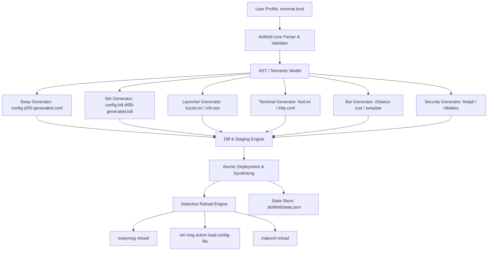

# Dotfield System Architecture

## 1. Executive Summary

**Dotfield** is a next-generation declarative dotfile and Linux ricing management system written in Rust. It decouples high-level user intent (the *what*) from low-level software syntax (the *how*).

Traditional dotfile managers (e.g., GNU Stow, chezmoi) manage symlinks or template files directly, but still require users to manually maintain duplicated configuration syntax across different window managers, terminal emulators, and utility daemons. Dotfield treats dotfiles as a compilation target, where a centralized TOML profile serves as the single source of truth.

---

## 2. Core Components

### 2.1 `dotfield-core`
- **Role**: Headless engine, library crate.
- **Responsibilities**:
  - **Schema & Deserialization**: Parses profile TOML files (`profiles/*.toml`) using Serde.
  - **Model Validation**: Validates keybinding consistency (checks for collisions, missing modifier keys, and unavailable binaries on `$PATH`).
  - **Target Generators**: Compiles abstract models into concrete configuration files for:
    - Compositors: Sway (`bindsym Mod4+Return exec foot`), Niri (`binds { Mod+Return { spawn "foot"; } }`).
    - Launchers: Fuzzel (`fuzzel.ini`), Rofi (`config.rasi`).
    - Terminals: Foot, Kitty, Alacritty, Ghostty.
    - Bars: `i3status-rust`, Swaybar, Waybar.
    - Shells: Zsh aliases and Starship palette overrides.
    - Sandboxing: Firejail profile overlays and NFTables rulesets.
  - **Diff Engine**: Computes AST or textual diffs between target system files and newly generated outputs.
  - **Transactional Staging**: Writes files to `.dotfield/staging/`, validates them, then atomically moves or creates symlinks to target destinations.
  - **State Ledger & Rollback**: Maintains a hash-chained ledger in `.dotfield/state.json` allowing immediate rollbacks via `dotfield rollback`.

### 2.2 `dotfield-cli`
- **Role**: Command-line binary (`dotfield`).
- **Commands**:
  - `dotfield status`: Reports currently active profile, compositor detected (Sway/Niri), drift detection, and state hash.
  - `dotfield check [profile]`: Static linting and dependency verification (e.g. alerts if `terminal = "foot"` is specified but `foot` is not installed).
  - `dotfield diff [profile]`: Colorized terminal diff showing exactly what will change across all generated files before application.
  - `dotfield apply [profile]`: Compiles, stages, atomically deploys, and selectively triggers reloads.
  - `dotfield rollback`: Reverts symlinks/files to the previous generation snapshot.
  - `dotfield list`: Displays available profiles (`minimal`, `hardening`, `default`).

### 2.3 `dotfield-shell`
- **Role**: High-performance native Wayland desktop shell built with **Pure Rust + Amane** (Vulkan and Vello backends).
- **Architecture**:
  - Zero WebKit, Electron, or Slint bloat; ultra-low CPU and memory footprints.
  - Instant IPC and zero-lag overlays communicated via Unix domain socket (`$XDG_RUNTIME_DIR/amane.sock`).
- **Integrated Capabilities**:
  - Status top bar with configurable modules and `--no-bar` toggle support.
  - Modern grid-based Application Launcher with arrow-key long-press scrolling.
  - Modern grid-based Terminal Manager with active terminal indicator.
  - Interactive Display Configurator for multi-monitor layout management.
  - Quick Settings Control Center and Notification HUD.
  - Monthly interactive Calendar and Wayland Screen Recorder.
  - System Powermenu (Lock, Sleep, Reboot, Shutdown).

### 2.4 `dotfieldd` (Optional Daemon)
- **Role**: Lightweight background event daemon.
- **Responsibilities**:
  - Listens to Wayland IPC events (workspace changes, display hotplugging).
  - Monitors system state (AC/Battery transitions, dark mode triggers).
  - Triggers profile adjustments dynamically (e.g., switches to power-saving bar intervals on battery).

---

## 3. The Compilation & Deployment Pipeline

1. **Profile Resolution**:
   The engine reads the active profile (e.g. `profiles/minimal.toml`). If inheritance is supported, base defaults are merged with the active profile.
2. **Keybinding Translation**:
   Abstract key combinations are parsed into an intermediate key representation:
   - `Super+Return` -> Modifier: `Super` (maps to `Mod4` in Sway/i3, `Mod` in Niri), Key: `Return`.
   - Command: `exec <app.terminal>`.
3. **Template / Fragment Synthesis**:
   Rather than rewriting entire monolithic configurations, Dotfield uses modular drop-in directories (`~/.config/sway/config.d/00-generated.conf` or `~/.config/niri/config.kdl.d/00-generated.kdl`). Base user configurations remain intact; Dotfield only owns the generated fragments.
4. **Staging & Verification**:
   The synthesized fragments are written to `.dotfield/staging/`. If any generator fails, the transaction aborts with zero side-effects.
5. **Atomic Swap**:
   The files are atomically moved or symlinked into target locations.
6. **Selective IPC Reload**:
   Only affected subsystems are signaled:
   - If only `fuzzel.ini` changed: no compositor reload needed.
   - If Sway bindings changed: execute `swaymsg reload`.
   - If Niri bindings changed: execute `niri msg action load-config-file`.
   - If Mako changed: execute `makoctl reload`.

---

## 4. Hardening and Security Layer

Dotfield integrates Linux security controls into the ricing workflow:
- **Firejail**: Automatic profile wrappers for network-facing applications (browsers, matrix clients).
- **NFTables**: Application-level firewall rulesets (`security/nft/`).
- **Flatpak**: Fine-grained sandbox permission overrides (`flatpak override --user ...`).
- **AppArmor**: Custom profiles for untrusted binary execution (`security/apparmor/`).

The `hardening.toml` profile activates these isolation boundaries automatically.
