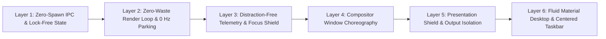

# Dotfield Architectural Roadmap (Layers 1–6)

This roadmap defines the active, production engineering layers for **Dotfield** and its native Wayland desktop shell **Amane** (`crates/amane-shell`) built for **Niri**, moving from sub-millisecond IPC and 0 Hz render parking through telemetry attribution, window choreography, presentation armor, and fluid material desktop controls.

---

## Phase 11: Layer 1: Zero-Spawn IPC Transport & Lock-Free State
*Goal: Eliminate fork/execve overhead for shell hotkeys via fast-path 1-byte opcode IPC datagrams, dedicated `amane-msg` standalone client, and lock-free compositor window tracking via `ArcSwap`.*

- [x] **Fast-Path 1-Byte IPC Engine**:
  - Implement 1-byte datagram opcode fast path (`0x01`–`0x17`) in `amane.sock` domain socket server.
  - Create standalone ultra-lightweight client `amane-msg` (sub-millisecond execution, ~1.7ms vs ~35ms previously).
- [x] **Lock-Free Compositor State Synchronization**:
  - Migrate `NiriWindowService` active window and output geometry cache to atomic `arc_swap::ArcSwapOption`.
- [x] **Keybind Optimization**:
  - Update `08-binds.kdl` to dispatch `amane-msg` directly for modals, OSDs, and workspace switching.

---

## Phase 12: Layer 2: Zero-Waste Vello Render Loop & GPU Power Profiles
*Goal: Eliminate background GPU wakeups, park Wayland frame requests at 0 Hz when idle, and implement top-of-minute aligned clock updates with 150ms modal summon easing.*

- [x] **Discrete Frame Dispatch & Change Tracking**:
  - Implement `request_changed_frames()` in `amane` engine, selectively dispatching Wayland `wl_surface::frame` callbacks only to surfaces with active damage.
  - Expose `quiet()` on service writers to eliminate spurious frame wakeups from unchanged states.
- [x] **Top-of-Minute Aligned Clock Service**:
  - Replace 1-second continuous tick loop with boundary-aligned sleep calculation (`((60 - second) * 1000).saturating_sub(subsec_millis) + 20ms`).
- [x] **Modal Summon Easing with 0 Hz Rest Parking**:
  - Implement `ModalTransition` with 150ms cubic ease-out transfer function (`1.0 - (1.0 - t).powi(3)`), automatically parking frame loops at 0 Hz the instant motion completes.

---

## Phase 13: Layer 3: Distraction-Free Telemetry & Focus Architecture
*Goal: Deliver visual silence and zero-polling telemetry via Linux PSI triggers, two-point delta culprit attribution, exception-only Ghost HUD, and contextual workspace focus shields.*

- [x] **Zero-Poll Linux PSI Sentinel & Stack pread() Reader**:
  - Monitor `/proc/pressure/cpu` and `/proc/pressure/memory` via `libc::poll` (`POLLPRI`) for true zero-poll event-driven wakeups.
  - Zero-heap stack `pread()` operations for `/proc/stat` and `/proc/meminfo`.
  - Cached battery sysfs descriptors under `/sys/class/power_supply/BAT*`.
- [x] **Two-Point Delta Culprit Attribution Engine**:
  - Sample PID ticks across a non-blocking 250ms background window to attribute runaway CPU processes.
  - Read `/proc/[pid]/statm` for top RSS resident memory consumers under memory pressure.
  - Cache attribution results for 2.0s to avoid redundant process scanning.
- [x] **Exception-Only Ghost HUD Capsule with Asymmetric Hysteresis**:
  - Suppress CPU, RAM, and Battery pills during normal loads (0 px width, 0 Hz Wayland parking).
  - Materialize amber/danger warning capsules when thresholds trip or PSI stalls fire.
  - Enforce 3.0s display floor and require metrics to drop below 75% CPU / 72% RAM for 3s before clearing.
  - Pointer interactivity: left-click launches Task Manager (`ghostty -e btop`).
- [x] **Contextual Focus Shield & 1.0 Full-Width Auto-Hide**:
  - Suppress non-critical notification popups in focus workspaces (`01 DEV`, `04 SECURITY`) into a silent steel dot (`•`).
  - Collapse top bar on 1.0 full-width columns, surfacing critical anomaly capsules as floating overlays (`exclusive_zone = 0`).

---

## Phase 14: Layer 4: Compositor Window Choreography & Developer Ergonomics
*Goal: Transform terminal launching and companion tooling into deterministic column configurations, floating scratchpads, and ergonomic window tiling in Niri.*

- [x] **Living Worktree Cells & Column Proportions**:
  - Declarative window rules in `compositor/niri/conf.d/06-window-tiling.kdl`: default 2/3 width for primary development windows (`^dev\\.`) and 1/3 width with `open-focused false` for companion sidecars (`^sidecar-`).
- [x] **Centred 960x600 Floating Scratchpad**:
  - Declarative window rule in `compositor/niri/conf.d/07-floating.kdl`: fixed 960x600 floating terminal for `floating-term`.
  - Hotkey bound in `08-binds.kdl`: `Mod+Ctrl+Return` spawning `ghostty --class=floating-term`.
- [x] **Ergonomic Window & Workspace Navigation**:
  - Vi-mode and arrow key column/window navigation, window consumption/expulsion, column width presets, and Blacksite workspace switching (`Mod+1` through `Mod+5`).

---

## Phase 15: Layer 5: Dynamic Multi-Monitor Topology & Zero-Disruption Presentation Shield
*Goal: Provide seamless external display hotplug management, hardware-level privacy gating, and an atomic zero-leak Presentation Shield with primary-only director HUD and notification FIFO buffering.*

- [x] **Fast-Path Presentation IPC Protocol**:
  - Define opcode `0x0E` (`OP_PRESENTATION`) in `crates/amane/src/ipc.rs` with `"presentation"` alias.
  - Add `presentation` subcommand to `amane-msg` for sub-2ms toggle latency without shell spawning.
- [x] **Native PresentationService & State Management**:
  - Implement `PresentationService` in `crates/amane-shell/src/services/presentation.rs` tracking `PresentationState { active: bool, start_time: Option<Instant> }` wrapped in `ArcSwap`.
  - Provide lock-free `is_active()`, `elapsed()`, `toggle()`, and single-head/multi-head state transitions.
- [x] **Notification Shield & In-Memory FIFO Queue**:
  - Suppress notification layer-shell popups when Presentation Mode is active.
  - Buffer non-critical notifications in an in-memory FIFO ring buffer (capped at 50 items) inside `NotificationService`.
  - Allow critical urgency notifications (e.g. Battery < 5% shutdown) to bypass suppression and render discreetly on primary display `eDP-1`.
  - Automatically drain and display buffered notifications sequentially upon disengaging Presentation Mode.
- [x] **Primary-Only Director HUD Stopwatch in Amane Bar**:
  - Render high-contrast presentation badge and elapsed stopwatch `󰐩 [PRESENTING] MM:SS` in `crates/amane-shell/src/ui/bar.rs`.
  - Isolate the widget strictly to primary internal display `eDP-1`, ensuring external presentation displays receive a clean, distraction-free viewport.
- [x] **Niri Workspace Quarantine & Kanshi Hotplug Integration**:
  - In `NiriService`, enforce workspace routing on external outputs to `05 PRESENTATION` or `03 RESEARCH`, preventing accidental exposure of `01 DEV` or `04 SECURITY`.
  - Integrate Kanshi profiles in `kanshi/config` to invoke `amane-msg presentation` on projector profile activation.
  - Bind `Mod+Shift+P` in `compositor/niri/conf.d/08-binds.kdl` to `spawn "amane-msg" "presentation"`.

---

## Phase 16: Layer 6: Fluid Material Desktop & Centered Taskbar Architecture
*Goal: Deliver a tactile, modern Wayland desktop with a configurable bottom-centered dock, centered Start Menu app grid, full spatial overview, and a consolidated Control Manager with live CAVA audio spectrum visualizer in Pure Rust + Vello GPU rendering.*

- [x] **Adaptive Bottom-Centered Dock (`ui/dock.rs`, `ui/bar.rs`)**:
  - Configurable bar positioning (`manifest.bar.position = "bottom" | "top"`).
  - Centered pinned applications and dynamic running window indicators with active status pips.
  - Window activation semantics: focus existing window on click, preview flyout for multi-instance, and shift/middle-click for new instance.
- [x] **Centered Start Menu & App Grid (`ui/start_menu.rs`)**:
  - 150ms cubic ease-out centered dock-anchored popup summoned via `Super` or `amane-msg start-menu`.
  - Live fuzzy search input, 4x3 pinned grid, A-Z categorized scrollable list, and session power bar.
- [x] **Spatial Ribbon Overview (`ui/overview.rs`)**:
  - Fullscreen semi-transparent backdrop overlay with bottom-anchored workspace cards and spatial Niri column miniatures summoned via `Mod+Tab` or `amane-msg overview`.
- [x] **Unified Control Manager & Calendar Hub (`ui/control_center.rs`)**:
  - Streamlined consolidation of all desktop controls, toggles, hardware sliders, and telemetry into a single unified WinUI 3-derived Control Center.
  - 6-button Quick Toggles ($2 \times 3$ grid): Wi-Fi, Bluetooth, DND, Display Config, Screen Record, Presentation Shield.
  - Hardware sliders for Output Volume and Display Brightness.
  - Live 20-band CAVA Audio Spectrum Visualizer integrated directly into the Media Player card with 0 Hz silent parking when audio is idle.
  - Interactive Month Calendar with Hero Digital Clock, Today indicator, and persistent Notifications history.
  - Fast subview navigation pills (`Net`, `Audio`, `BlueZ`, `Cal`, `Tray`).
- [x] **Fast-Path IPC Protocols & Zero-Poll Power Invariants**:
  - Fast-path 1-byte opcodes for `start-menu` (`0x15`), `overview` (`0x17`), `control-center` (`0x04`), with legacy `widgets` (`0x0F`) and `action-center` (`0x16`) aliased cleanly to Control Manager.
  - Strict 0 Hz Wayland frame request parking at rest across all desktop surfaces.

---

## Phase 17: Bento Widgets Architecture & Cyber Synthwave Unification
*Goal: Reclaim `OP_WIDGETS = 0x0F` with a dedicated left-anchored `Layer::Overlay` Widget Board (`380px`), unify all shell surfaces onto canonical Cyber Synthwave (`PALETTE.md`) with WCAG-compliant contrast tokens, and deliver FocusShield sprint presets and 5m telemetry sparklines with 0 Hz parking.*

- [ ] **Cyber Synthwave Design System & Contrast Guard**:
  - Align `shell.toml`, `config.rs`, and `tokens.rs` with `PALETTE.md` tokens (`#000000` / `#140e29` / `#251b4a` / `#04C5F0` / `#14B9B5`).
  - Introduce verified contrast tokens (`text_on_elevated = #61E6FF`, `text_on_accent = #000000`, `text_on_danger`, `text_on_danger_critical`).
  - Update `DESIGN.md` and enforce bottom `48.0px` bar position with dynamic `effective_h >= 40.0px` floor.
- [ ] **Bento Primitives & Editorial Section Kit (`ui/components.rs`)**:
  - Implement `editorial_section` container (`352px` wide, `14px` pad, `1px #251b4a`).
  - Implement `bento_gauge_ring` (`64px` diameter, `Arc` based) and `bento_sparkline` with `<2` sample baseline.
- [ ] **Modular Widget Board & Cards (`ui/widgets/`)**:
  - Reclaim `OP_WIDGETS` (`0x0F`), bind `Mod+W`, and add dock status trigger (`dock.rs`).
  - Implement `widgets_board_overlay` (`ui/widgets/board.rs`) with `Keyboard::OnDemand` and `SpringTransition` physics.
  - Implement `ui/widgets/cards.rs` with 6 `WidgetKind` cards (`FocusShield` hero, `Telemetry`, `Media` + CAVA, `Clock`, `Workspaces`, `Notifications`).
- [ ] **Zero-Poll Signal Wakeup & Service Expansions**:
  - `PresentationSignal`, `TelemetrySignal`, and `CavaSignal` event-loop wakeup markers.
  - FocusShield sprint presets (`25m`/`50m`/`Free`) and notification dismiss-on-capture.
  - Telemetry 5m ring buffers, seeded procfs startup, and ancestor-PPID window jumping.
