# Dotfield Multi-Phase Implementation Roadmap

This roadmap defines the structured, logical development phases for **Dotfield**, moving from foundational tooling and base dotfile configurations through security hardening, native Rust compiler CLI, and graphical Slint utilities.

```mermaid
flowchart LR
    P1[Phase 1: Foundation & Tooling] --> P2[Phase 2: Compositor & Launchers]
    P2 --> P3[Phase 3: Terminals & Multiplexers]
    P3 --> P4[Phase 4: Notifications & Utilities]
    P4 --> P5[Phase 5: Security & Profiles]
    P5 --> P6[Phase 6: Native Rust CLI Engine]
    P6 --> P7[Phase 7: Custom Slint GUIs]
    P7 --> P8[Phase 8: Non-Rust Performance & Latency]
    P8 --> P9[Phase 9: Comprehensive UI & UX Overhaul]
```

---

## Phase 1: Foundation, Quality Gates, Tooling & Documentation
*Goal: Establish a solid engineering substrate, security scanning, CI linting, and architectural blueprints.*

- [x] **Documentation**:
  - `GEMINI.md`: Development rules, security standards, and contribution guide.
  - `docs/ARCHITECTURE.md`: High-level system design, data flow, compilation pipeline, and reload mechanics.
  - `docs/ROADMAP.md`: Multi-phase milestone definitions and verification criteria.
  - `docs/PROFILES.md`: Schema specification for TOML profiles.
- [x] **Git & Environment Configuration**:
  - `.gitignore`: Comprehensive ignore rules for Rust builds, dotfield state, editor files, and credentials.
- [x] **Security & Quality Tooling**:
  - `.pre-commit-config.yaml`: Automated pre-commit hooks.
  - `.gitleaks.toml`: Secret and token leakage prevention.
  - `.semgrep.yml`: Static analysis rules for Rust, shell scripts, and configuration permissions.
  - Pre-commit verification: verify all checks pass clean on git-tracked files.

---

## Phase 2: Compositor, Launchers & Shell Setup
*Goal: Build modular, fragment-friendly baseline configurations for Wayland window management, application launchers, and command shells.*

- [x] **Compositors (`compositor/`)**:
  - **Sway (`compositor/sway/`)**:
    - Base config structure with `include ~/.config/sway/config.d/*.conf`.
    - Keybinding fragment targets (`00-generated-bindings.conf`).
    - Window rules, workspace definitions, input/output device handling.
  - **Niri (`compositor/niri/`)**:
    - Scrollable-tiling KDL modular configurations (`config.kdl`).
    - Keybinding block abstractions (`include "config.kdl.d/00-generated-bindings.kdl"`).
- [x] **Launchers (`launcher/`)**:
  - **Fuzzel (`launcher/fuzzel/`)**: Wayland-native lightweight launcher with dynamic theme variables.
  - **Rofi (`launcher/rofi/`)**: Wayland-fork (Wayland Rofi) rasi theme configurations and modes (drun, run, window).
- [x] **Shell Environment (`shell/`)**:
  - **Zsh (`shell/zsh/`)**: Clean modular `.zshrc`, plugins, aliases, and environment variables.
  - **Starship (`shell/starship/`)**: Cross-shell prompt preset with color palette overrides matching active dotfield profile.

---

## Phase 3: Terminals, Neovim, Multiplexers & Status Bars
*Goal: Provide developer productivity tools with uniform color tokenization and shared keybinding ergonomics.*

- [x] **Terminals (`terminals/`)**:
  - **Foot (`terminals/foot/`)**: Fast, lightweight Wayland terminal with client-server support.
  - **Kitty (`terminals/kitty/`)**: GPU-accelerated terminal with socket control for live color switching (`kitten @ set-colors`).
  - **Alacritty (`terminals/alacritty/`)**: High-performance TOML configuration.
  - **Ghostty (`terminals/ghostty/`)**: Native Wayland modern terminal.
- [x] **Editor (`nvim/`)**:
  - Modular Neovim Lua setup (modular options, keymaps, clean structure).
  - Theme synchronization hook listening to Dotfield profile color palettes.
- [x] **Multiplexers (`multiplexer/`)**:
  - **Zellij (`multiplexer/zellij/`)**: KDL configuration, layouts, and status bar integration.
  - **Tmux (`multiplexer/tmux/`)**: Minimal tmux configuration with vi-mode keybindings and dynamic colors.
- [x] **Status Bars (`i3-rust/` & Swaybar)**:
  - **i3status-rust**: Modern status bar blocks (CPU, memory, battery, network, sound, time).
  - Swaybar / Waybar fallback definitions.

---

## Phase 4: Desktop OSD, Notifications & Utilities
*Goal: Deliver responsive user feedback, volume/brightness overlays, and notifications.*

- [x] **Notifications (`mako/`)**:
  - Wayland notification daemon configuration (`~/.config/mako/config`).
  - Style rules for normal, low, and critical urgency levels.
  - Reload hook (`makoctl reload`).
- [x] **On-Screen Display (`osd/`)**:
  - **SwayOSD / Avizo / Lock & Idle**: Minimal indicator ring lockscreen (`swaylock`) and idle timeout management (`swayidle`).
- [x] **System Utilities**:
  - Screenshot pipeline (grim + slurp + wl-copy).
  - Wallpaper management (swaybg / wbg).
  - Idle management and screen locking (swayidle + swaylock / hyprlock).

---

## Phase 5: Security Hardening & Isolation Policies
*Goal: Formalize sandboxing policies, firewall rulesets, and runtime enforcement.*

- [x] **Security Modules (`security/`)**:
  - **Bubblewrap (`bwrap`)**: Standalone browser sandbox wrapper (`scripts/sandbox-browser.sh`) mounting ephemeral isolated tmpfs filesystems and masking `/etc/machine-id`.
  - **AppArmor (`security/apparmor/`)**: Binary-attached confinement profile for `amane` with kernel state verification via `/sys/kernel/security/apparmor/profiles`.
  - **Flatpak (`security/flatpak/`)**: Declarative permission overrides (`--nosocket=x11`, `--socket=wayland`, pipewire features).
  - **NFTables (`security/nft/`)**: Workstation firewall ruleset (`dotfield.nft`) with persistent inclusion via `/etc/nftables.conf` and user-controlled port manager utility (`scripts/fw-open`).

---

## Phase 6: Native Core & CLI Engine [SUPERSEDED]
*Goal: Implement the Rust compiler, validation engine, transactional deployer, and CLI tool.*

> [!NOTE]
> **ARCHITECTURAL PIVOT**:
> The standalone `dotfield-compiler` CLI and intermediate TOML compiler engine (`dotfield-core`, `dotfield-cli`) were superseded in favor of native modular drop-in configurations (`conf.d/*.kdl`, `conf.d/*.conf`) deployed directly via `setup.sh`. This removed compiler compilation overhead and runtime fragility while preserving zero-bloat modularity.

---

## Phase 7: Custom GUI Utilities [SUPERSEDED]
*Goal: Deliver smooth, native Wayland graphical interfaces for profile management and system interaction.*

> [!NOTE]
> **ARCHITECTURAL PIVOT**:
> Standalone Slint GUI prototypes (`crates/dotfield-gui/`) were superseded in favor of **`crates/amane-shell`** (`amane`) — a unified, high-performance native Wayland desktop shell suite built with Pure Rust + Vulkan GPU rendering exclusively for Niri.

---

## Phase 8: Non-Rust Desktop System Performance, Latency Optimization, and Productivity Hardening
*Goal: Synchronize and optimize all non-Rust desktop configuration fragments, scripts, themes, and pipelines for sub-millisecond input latency, instantaneous shell prompt rendering, and unified vi-mode navigation.*

- [x] **Compositors (`compositor/`)**:
  - **Sway (`compositor/sway/config`)**:
    - Configure `output * max_render_time 1` for vblank-synchronized frame dispatch.
    - Accelerate typematic repeat to `repeat_delay 200` ms and `repeat_rate 50` cps.
    - Enable `output * adaptive_sync on` (VRR).
  - **Niri (`compositor/niri/config.kdl`)**:
    - Accelerate input repeat rates to `repeat-delay 200` and `repeat-rate 50`.
    - Optimize window animation curves and focus transitions.
- [x] **Shell & Prompt (`shell/`)**:
  - **Zsh (`shell/zsh/.zshrc`)**:
    - Eliminate vi-mode mode switch lag with `export KEYTIMEOUT=1` (10ms).
    - Implement 24-hour timestamp check for `compinit -C` to accelerate shell startup.
    - Add `AUTO_CD`, `AUTO_PUSHD`, and completion caching rules.
  - **Starship (`shell/starship/starship.toml`)**:
    - Enforce sub-10ms prompt rendering with `scan_timeout = 10` and `command_timeout = 150`.
    - Optimize git status query thresholds for massive workspaces.
- [x] **Terminals (`terminals/`)**:
  - **Kitty (`terminals/kitty/kitty.conf`)**:
    - Set `repaint_delay 6`, `input_delay 1`, `sync_to_monitor yes`, and `wayland_enable_ime no`.
  - **Foot (`terminals/foot/foot.ini`)**:
    - Set `box-drawings-uses-font-glyphs=yes` and `gamma-correct-blending=no`.
  - **Ghostty (`terminals/ghostty/config`)**:
    - Set `gtk-single-instance = true` and `auto-update = "off"`.
- [x] **Multiplexers (`multiplexer/`)**:
  - **Tmux (`multiplexer/tmux/tmux.conf`)**:
    - Eliminate 500ms escape lag with `set -s escape-time 0`.
    - Enable `focus-events on`, `history-limit 50000`, and vi-mode copy pipe to `wl-copy`.
  - **Zellij (`multiplexer/zellij/config.kdl`)**:
    - Set `copy_command "wl-copy"` and `copy_on_select true`.
- [x] **Editor (`nvim/`)**:
  - **Neovim Options (`nvim/lua/core/options.lua`)**:
    - Set `opt.updatetime = 100`, `opt.undofile = true`, `opt.swapfile = false`, and `opt.synmaxcol = 300`.
- [x] **Launchers (`launcher/`)**:
  - **Fuzzel (`launcher/fuzzel/fuzzel.ini`)**: Set `layer=overlay`, `match-mode=fzf`, and `exit-on-keyboard-focus-loss=yes`.
  - **Rofi (`launcher/rofi/config.rasi`)**: Enable `matching: "fuzzy"`, `sorting-method: "fzf"`, and `threads: 0`.
- [x] **Utilities & Scripts (`scripts/`)**:
  - **Screenshot (`scripts/screenshot.sh`)**: Pipe `grim` directly to `wl-copy` while teeing to destination file to eliminate disk-wait latency.

---

## Phase 9: Comprehensive UI & UX Overhaul (Slint Desktop Craft, Tokens, & Desktop Experience)
*Goal: Re-architect and polish all desktop visual surfaces, design tokens, Slint GUI components, application launchers, and notification styling according to the Controlled Chaos design system and Impeccable craft floor.*

- [x] **Design Tokens (`crates/dotfield-gui/ui/palette.slint`)**:
  - Complete tokenization of Controlled Chaos colors (`void`, `obsidian`, `graphite`, `iron`, `ash`, `bone`, `amber`, `pale-amber`, `crimson`, `blood-red`, `steel`, `success-green`).
  - Standardized font scale, spacing rhythm, and border radii.
- [x] **Keybind HUD (`crates/dotfield-gui/ui/hud.slint`)**:
  - Authored vector close button with responsive hover feedback.
  - Reactive search bar with focus ring and keyboard input affordances.
  - Zero-match empty state with contextual troubleshooting tips.
  - Styled keyboard modifier chips (`Super`, `Ctrl`, `Alt`) and action key pills.
  - Styled category badges (`apps`, `window`, `system`) and `[Esc]` dismissal hints.
- [x] **Profile Switcher (`crates/dotfield-gui/ui/switcher.slint`)**:
  - Tactile numeric hotkey badges (`[1]`, `[2]`, `[3]`) for rapid keyboard switching.
  - Card elevation, subtle depth borders, and smooth hover state transitions.
  - Discrete semantic metadata chips (Compositor, Apps, Security).
  - Tactile Apply button micro-interactions and generational status feedback.
- [x] **Launchers & Notifications**:
  - **Fuzzel (`launcher/fuzzel/fuzzel.ini`)**: 8px border radius, Controlled Chaos selection colors, symmetric padding.
  - **Rofi (`launcher/rofi/config.rasi`)**: 8px radius, clean search input styling, amber selection indicator.
  - **Mako (`mako/config`)**: 8px radius, urgency border hierarchy (Amber, Iron, Crimson).
- [x] **Prompts & Bars**:
  - **Starship (`shell/starship/starship.toml`)**: Mode-specific visual indicators and crisp symbol delimiters.
  - **i3status-rust (`i3-rust/config.toml`)**: Clean status spacing and urgency accent tokens.

---

## Phase 10: Native Niri Desktop Shell Engine via Amane (Pure Rust Wayland Shell Suite)
*Goal: Consolidate Niri desktop surfaces into a single, unified, GPU-accelerated Wayland desktop shell suite (`amane`, `crates/amane-shell`) using Amane (`MystiaFin/amane`), replacing i3bar-river, i3status-rs, mako, and swayosd with native status bar, workspace radar, OSD, notifications, launcher, terminal manager, and control center.*

- [x] **Unified Amane Shell Crate (`crates/amane-shell`, binary: `amane`)**:
  - Implement workspace crate with `amane`, `wgpu`, `niri-ipc`, `zbus`.
  - Subsystem 1: Status Bar with Niri spatial workspace radar & system pills.
  - Subsystem 2: Ephemeral OSD sliders for volume & brightness (direct hardware control).
  - Subsystem 3: Native `org.freedesktop.Notifications` D-Bus daemon.
  - Subsystem 4: Application launcher modal grid with fuzzy `.desktop` search.
  - Subsystem 5: Terminal manager modal grid with active window indicators.
  - Subsystem 6: Control center & modular widgets (Wi-Fi, Bluetooth, Audio, Power, Notification drawer).
  - Subsystem 7: Monthly interactive Calendar and Wayland Screen Recorder.
- [x] **Compositor & Systemd Integration**:
  - Update `compositor/niri/conf.d/` to autostart `amane` via `systemctl --user start amane.service`.
  - Bind hotkeys for launcher, terminal manager, control center, and OSD volume/brightness keys.
  - Supervise daemon under systemd user manager with automatic recovery across output disconnects and DPMS sleep.
- [x] **Quality & CI Verification**:
  - Comprehensive unit tests (`cargo test -p amane-shell`), `cargo clippy -- -D warnings`, and live validation.

---

## Phase 11: Layer 1: Zero-Spawn IPC Transport & Lock-Free State
*Goal: Eliminate fork/execve overhead for shell hotkeys via fast-path 1-byte opcode IPC datagrams, dedicated `amane-msg` standalone client, and lock-free compositor window tracking via `ArcSwap`.*

- [x] **Fast-Path 1-Byte IPC Engine**:
  - Implement 1-byte datagram opcode fast path (`0x01`–`0x07`) in `amane.sock` domain socket server.
  - Create standalone ultra-lightweight client `amane-msg` (sub-millisecond execution, ~1.7ms vs ~35ms previously).
- [x] **Lock-Free Compositor State Synchronization**:
  - Migrate `NiriWindowService` active window and output geometry cache to atomic `arc_swap::ArcSwapOption`.
- [x] **Keybind Optimization**:
  - Update `04-keybinds.kdl` to dispatch `amane-msg` directly for modals, OSDs, and workspace switching.

---

## Phase 12: Layer 2: Zero-Waste Vello Render Loop & GPU Power Profiles
*Goal: Eliminate background GPU wakeups, park Wayland frame requests at 0 Hz when idle, and implement top-of-minute aligned clock updates with 150ms modal summon easing.*

- [x] **Discrete Frame Dispatch & Change Tracking**:
  - Implement `request_changed_frames()` in `amane` engine, selectively dispatching Wayland `wl_surface::frame` callbacks only to surfaces with active damage.
  - Expose `quiet()` on service writers to eliminate spurious frame wakeups from unchanged states.
- [x] **Top-of-Minute Aligned Clock Service**:
  - Replace 1-second continuous tick loop with boundary-aligned sleep calculation (`((60 - second) * 1000).saturating_sub(subsec_millis) + 20ms`).
- [x] **Modal Summon Easing with 0 Hz Rest Parking**:
  - Implement `ModalTransition` with 150ms cubic ease-out transfer function (`1.0 - (1.0 - t).powi(3)`), automatically parking frame loops at 0 Hz the instant motion completes.

---

## Phase 13: Layer 3: Distraction-Free Telemetry & Focus Architecture
*Goal: Deliver visual silence and zero-polling telemetry via Linux PSI triggers, two-point delta culprit attribution, exception-only Ghost HUD, and contextual workspace focus shields.*

- [x] **Zero-Poll Linux PSI Sentinel & Stack pread() Reader**:
  - Monitor `/proc/pressure/cpu` and `/proc/pressure/memory` via `libc::poll` (`POLLPRI`) for true zero-poll event-driven wakeups.
  - Zero-heap stack `pread()` operations for `/proc/stat` and `/proc/meminfo`.
  - Cached battery sysfs descriptors under `/sys/class/power_supply/BAT*`.
- [x] **Two-Point Delta Culprit Attribution Engine**:
  - Sample PID ticks across a non-blocking 250ms background window to attribute runaway CPU processes.
  - Read `/proc/[pid]/statm` for top RSS resident memory consumers under memory pressure.
  - Cache attribution results for 2.0s to avoid redundant process scanning.
- [x] **Exception-Only Ghost HUD Capsule with Asymmetric Hysteresis**:
  - Suppress CPU, RAM, and Battery pills during normal loads (0 px width, 0 Hz Wayland parking).
  - Materialize amber/danger warning capsules when thresholds trip or PSI stalls fire.
  - Enforce 3.0s display floor and require metrics to drop below 75% CPU / 72% RAM for 3s before clearing.
  - Pointer interactivity: left-click copies culprit PID and name via `wl-copy`.
- [x] **Contextual Focus Shield & 1.0 Full-Width Auto-Hide**:
  - Suppress non-critical notification popups in focus workspaces (`01 DEV`, `04 SECURITY`) into a silent steel dot (`•`).
  - Collapse top bar on 1.0 full-width columns, surfacing critical anomaly capsules as floating overlays (`exclusive_zone = 0`).

---

## Phase 14: Layer 4: Compositor Window Choreography & Developer Ergonomics
*Goal: Transform terminal launching into a deterministic project topology router, warping Niri ribbons to existing project columns or spawning atomic living worktree cell pairs with automatic sidecars and instant floating scratchpads.*

- [x] **Project Topology & Session Discovery Engine**:
  - Implement `TopologyService` in `crates/amane-shell/src/services/topology.rs` with lock-free `ArcSwap` caching and async refresh.
  - Automatically discover Git worktrees via `git worktree list --porcelain`, active Tmux sessions via `tmux list-sessions`, and repositories under `~/dev/projects/`.
- [x] **Niri Spatial Ribbon Warping & Worktree Cell Spawning**:
  - Add `jump_or_spawn_project` and `spawn_sidecar_for_focused` to `NiriService`.
  - Intelligently warp ribbon focus to existing columns matching project app IDs (`dev.<slug>`), or switch to `01 DEV` and launch atomic paired columns: primary terminal (2/3 width) and background companion sidecar (1/3 width, `open-focused false`).
- [x] **Fast-Path IPC Protocol Extensions**:
  - Wire `"topology"` alias to fast-path opcode `0x02` (`OP_TERMINAL_MGR`) in `crates/amane/src/ipc.rs`.
  - Add opcode `0x0D` (`OP_SIDECAR`) for instant hotkey sidecar spawning beside Neovim/terminals.
  - Expose CLI subcommands `amane-msg topology` and `amane-msg sidecar`.
- [x] **Interactive Project Topology Switcher UI**:
  - Refactor `terminal_manager.rs` into a dual-mode project & terminal switcher with `Tab` key toggling.
  - Real-time fuzzy filtering across project names, git branches, and paths.
  - Visual badges for Git worktree branch (`󰘬`), active Tmux session (`󰓩`), and dev target status.
- [x] **Declarative Window Rules & Hotkey Mappings**:
  - `compositor/niri/conf.d/06-window-tiling.kdl`: Default 2/3 width for `^dev\\.` windows and 1/3 width with `open-focused false` for `^sidecar-` windows.
  - `compositor/niri/conf.d/07-floating.kdl`: 960x600 centered rule for `floating-term` scratchpad.
  - `compositor/niri/conf.d/08-binds.kdl`: `Mod+Shift+Return` for topology router, `Mod+Alt+Return` for sidecar, `Mod+Ctrl+Return` for scratchpad, preserving `Mod+Escape` for screen lock.

---

## Phase 15: Layer 5: Dynamic Multi-Monitor Topology & Zero-Disruption Presentation Shield
*Goal: Provide seamless external display hotplug management, hardware-level privacy gating, and an atomic zero-leak Presentation Shield with primary-only director HUD and notification FIFO buffering.*

- [ ] **Fast-Path Presentation IPC Protocol**:
  - Define opcode `0x0E` (`OP_PRESENTATION`) in `crates/amane/src/ipc.rs` with `"presentation"` alias.
  - Add `presentation` subcommand to `amane-msg` for sub-2ms toggle latency without shell spawning.
- [ ] **Native PresentationService & State Management**:
  - Implement `PresentationService` in `crates/amane-shell/src/services/presentation.rs` tracking `PresentationState { active: bool, start_time: Option<Instant> }` wrapped in `ArcSwap`.
  - Provide lock-free `is_active()`, `elapsed()`, `toggle()`, and single-head/multi-head state transitions.
- [ ] **Notification Shield & In-Memory FIFO Queue**:
  - Suppress notification layer-shell popups when Presentation Mode is active.
  - Buffer non-critical notifications in an in-memory FIFO ring buffer (capped at 50 items) inside `NotificationService`.
  - Allow critical urgency notifications (e.g. Battery < 5% shutdown) to bypass suppression and render discreetly on primary display `eDP-1`.
  - Automatically drain and display buffered notifications sequentially upon disengaging Presentation Mode.
- [ ] **Primary-Only Director HUD Stopwatch in Amane Bar**:
  - Render high-contrast presentation badge and elapsed stopwatch `󰐩 [PRESENTING] MM:SS` in `crates/amane-shell/src/ui/bar.rs`.
  - Isolate the widget strictly to primary internal display `eDP-1`, ensuring external presentation displays receive a clean, distraction-free viewport.
- [ ] **Niri Workspace Quarantine & Kanshi Hotplug Integration**:
  - In `NiriService`, enforce workspace routing on external outputs to `05 PRESENTATION` or `03 RESEARCH`, preventing accidental exposure of `01 DEV` or `04 SECURITY`.
  - Integrate Kanshi profiles in `kanshi/config` to invoke `amane-msg presentation` on projector profile activation.
  - Bind `Mod+Shift+P` in `compositor/niri/conf.d/08-binds.kdl` to `spawn "amane-msg" "presentation"`.
