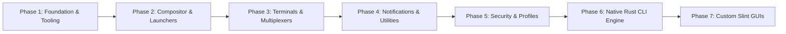

# Dotfield Multi-Phase Implementation Roadmap

This roadmap defines the structured, logical development phases for **Dotfield**, moving from foundational tooling and base dotfile configurations through security hardening, native Rust compiler CLI, and graphical Slint utilities.

---

## Phase 1: Foundation, Quality Gates, Tooling & Documentation (Current)
*Goal: Establish a solid engineering substrate, security scanning, CI linting, and architectural blueprints.*

- [x] **Documentation**:
  - `GEMINI.md`: Development rules, security standards, and contribution guide.
  - `docs/ARCHITECTURE.md`: High-level system design, data flow, compilation pipeline, and reload mechanics.
  - `docs/ROADMAP.md`: Multi-phase milestone definitions and verification criteria.
  - `docs/PROFILES.md`: Schema specification for TOML profiles.
- [x] **Git & Environment Configuration**:
  - `.gitignore`: Comprehensive ignore rules for Rust builds, dotfield state, editor files, and credentials.
- [x] **Security & Quality Tooling**:
  - `.pre-commit-config.yaml`: Automated pre-commit hooks.
  - `.gitleaks.toml`: Secret and token leakage prevention.
  - `.semgrep.yml`: Static analysis rules for Rust, shell scripts, and configuration permissions.
  - Pre-commit verification: verify all checks pass clean on git-tracked files.

---

## Phase 2: Compositor, Launchers & Shell Setup
*Goal: Build modular, fragment-friendly baseline configurations for Wayland window management, application launchers, and command shells.*

- [ ] **Compositors (`compositor/`)**:
  - **Sway (`compositor/sway/`)**:
    - Base config structure with `include ~/.config/sway/config.d/*.conf`.
    - Keybinding fragment targets (`00-generated-bindings.conf`).
    - Window rules, workspace definitions, input/output device handling.
  - **Niri (`compositor/niri/`)**:
    - Scrollable-tiling KDL modular configurations (`config.kdl`).
    - Keybinding block abstractions (`include "config.kdl.d/generated.kdl"`).
- [ ] **Launchers (`launcher/`)**:
  - **Fuzzel (`launcher/fuzzel/`)**: Wayland-native lightweight launcher with dynamic theme variables.
  - **Rofi (`launcher/rofi/`)**: Wayland-fork (Wayland Rofi) rasi theme configurations and modes (drun, run, window).
- [ ] **Shell Environment (`shell/`)**:
  - **Zsh (`shell/zsh/`)**: Clean modular `.zshrc`, plugins, aliases, and environment variables.
  - **Starship (`shell/starship/`)**: Cross-shell prompt preset with color palette overrides matching active dotfield profile.

---

## Phase 3: Terminals, Neovim, Multiplexers & Status Bars
*Goal: Provide developer productivity tools with uniform color tokenization and shared keybinding ergonomics.*

- [x] **Terminals (`terminals/`)**:
  - **Foot (`terminals/foot/`)**: Fast, lightweight Wayland terminal with client-server support.
  - **Kitty (`terminals/kitty/`)**: GPU-accelerated terminal with socket control for live color switching (`kitten @ set-colors`).
  - **Alacritty (`terminals/alacritty/`)**: High-performance TOML configuration.
  - **Ghostty (`terminals/ghostty/`)**: Native Wayland modern terminal.
- [x] **Editor (`nvim/`)**:
  - Modular Neovim Lua setup (modular options, keymaps, clean structure).
  - Theme synchronization hook listening to Dotfield profile color palettes.
- [x] **Multiplexers (`multiplexer/`)**:
  - **Zellij (`multiplexer/zellij/`)**: KDL configuration, layouts, and status bar integration.
  - **Tmux (`multiplexer/tmux/`)**: Minimal tmux configuration with vi-mode keybindings and dynamic colors.
- [x] **Status Bars (`i3-rust/` & Swaybar)**:
  - **i3status-rust**: Modern status bar blocks (CPU, memory, battery, network, sound, time).
  - Swaybar / Waybar fallback definitions.

---

## Phase 4: Desktop OSD, Notifications & Utilities
*Goal: Deliver responsive user feedback, volume/brightness overlays, and notifications.*

- [x] **Notifications (`mako/`)**:
  - Wayland notification daemon configuration (`~/.config/mako/config`).
  - Style rules for normal, low, and critical urgency levels.
  - Reload hook (`makoctl reload`).
- [x] **On-Screen Display (`osd/`)**:
  - **SwayOSD / Avizo / Lock & Idle**: Minimal indicator ring lockscreen (`swaylock`) and idle timeout management (`swayidle`).
- [x] **System Utilities**:
  - Screenshot pipeline (grim + slurp + wl-copy).
  - Wallpaper management (swaybg / wbg).
  - Idle management and screen locking (swayidle + swaylock / hyprlock).

---

## Phase 5: Security Hardening & Profile Definitions
*Goal: Formalize sandboxing policies, firewall rulesets, and concrete user profile configurations.*

- [x] **Security Modules (`security/`)**:
  - **Firejail (`security/firejail/`)**: Custom profiles for web browsers, electron apps, and untrusted binaries.
  - **AppArmor (`security/apparmor/`)**: Hardened profiles for sensitive background daemons.
  - **Flatpak (`security/flatpak/`)**: Declarative permission overrides (`socket = ["wayland", "!x11"]`, pipewire features).
  - **NFTables (`security/nft/`)**: Workstation firewall ruleset (blocking unsolicited inbound, loopback accept, established/related tracking).
- [x] **Concrete Profiles (`profiles/`)**:
  - `profiles/default.toml`: Balanced daily-driver rice (Foot, Fuzzel, Sway, Starship, Zellij, Mako).
  - `profiles/minimal.toml`: Ultra-lightweight setup for low-resource environments (Foot, Fuzzel, Niri, Tmux).
  - `profiles/hardening.toml`: Maximum isolation profile with strict Firejail wrapping, AppArmor drop-ins, and NFTables enforcement.

---

## Phase 6: Native Core & CLI Engine (`dotfield-core` & `dotfield-cli`)
*Goal: Implement the Rust compiler, validation engine, transactional deployer, and CLI tool.*

- [x] **Crate Architecture (`crates/`)**:
  - `dotfield-core`:
    - TOML deserializers for Profiles, Apps, Bindings, Themes, Security.
    - Path and binary resolution on `$PATH`.
    - Template generation engine (converting semantic bindings to Sway, Niri, Fuzzel configs).
    - Diff and transaction staging manager (`.dotfield/staging`).
    - Selective reload controller (IPC commands for Sway, Niri, Mako, etc.).
    - State journal and rollback logic (`.dotfield/state.json`).
  - `dotfield-cli`:
    - Commands: `status`, `check`, `diff`, `apply`, `rollback`, `list`.
    - Rich terminal outputs with color-coded diffs using `colored` and `similar`.

---

## Phase 7: Custom GUI Utilities (Rust + Slint)
*Goal: Deliver smooth, native Wayland graphical interfaces for profile management and system interaction.*

- [ ] **Slint GUI Utilities (`crates/dotfield-gui/`)**:
  - **Rice Menu (`rice-menu`)**: Quick Wayland popover for toggling profiles, themes, and screen scale.
  - **Profile Switcher (`profile-switcher`)**: Graphical card viewer displaying rice presets with live screenshots/previews.
  - **Keybind HUD (`keybind-hud`)**: Instant searchable cheat-sheet showing current active keybindings compiled by Dotfield.
- [ ] **Daemon (`dotfieldd`)**:
  - Background event subscriber for automatic profile switching (AC/Battery, display dock/undock).
