# Dotfield Multi-Phase Implementation Roadmap

This roadmap defines the structured, logical development phases for **Dotfield**, moving from foundational tooling and base dotfile configurations through security hardening, native Rust compiler CLI, and graphical Slint utilities.

```mermaid
flowchart LR
    P1[Phase 1: Foundation & Tooling] --> P2[Phase 2: Compositor & Launchers]
    P2 --> P3[Phase 3: Terminals & Multiplexers]
    P3 --> P4[Phase 4: Notifications & Utilities]
    P4 --> P5[Phase 5: Security & Profiles]
    P5 --> P6[Phase 6: Native Rust CLI Engine]
    P6 --> P7[Phase 7: Custom Slint GUIs]
    P7 --> P8[Phase 8: Non-Rust Performance & Latency]
    P8 --> P9[Phase 9: Comprehensive UI & UX Overhaul]
```

---

## Phase 1: Foundation, Quality Gates, Tooling & Documentation
*Goal: Establish a solid engineering substrate, security scanning, CI linting, and architectural blueprints.*

- [x] **Documentation**:
  - `GEMINI.md`: Development rules, security standards, and contribution guide.
  - `docs/ARCHITECTURE.md`: High-level system design, data flow, compilation pipeline, and reload mechanics.
  - `docs/ROADMAP.md`: Multi-phase milestone definitions and verification criteria.
  - `docs/PROFILES.md`: Schema specification for TOML profiles.
- [x] **Git & Environment Configuration**:
  - `.gitignore`: Comprehensive ignore rules for Rust builds, dotfield state, editor files, and credentials.
- [x] **Security & Quality Tooling**:
  - `.pre-commit-config.yaml`: Automated pre-commit hooks.
  - `.gitleaks.toml`: Secret and token leakage prevention.
  - `.semgrep.yml`: Static analysis rules for Rust, shell scripts, and configuration permissions.
  - Pre-commit verification: verify all checks pass clean on git-tracked files.

---

## Phase 2: Compositor, Launchers & Shell Setup
*Goal: Build modular, fragment-friendly baseline configurations for Wayland window management, application launchers, and command shells.*

- [x] **Compositors (`compositor/`)**:
  - **Sway (`compositor/sway/`)**:
    - Base config structure with `include ~/.config/sway/config.d/*.conf`.
    - Keybinding fragment targets (`00-generated-bindings.conf`).
    - Window rules, workspace definitions, input/output device handling.
  - **Niri (`compositor/niri/`)**:
    - Scrollable-tiling KDL modular configurations (`config.kdl`).
    - Keybinding block abstractions (`include "config.kdl.d/00-generated-bindings.kdl"`).
- [x] **Launchers (`launcher/`)**:
  - **Fuzzel (`launcher/fuzzel/`)**: Wayland-native lightweight launcher with dynamic theme variables.
  - **Rofi (`launcher/rofi/`)**: Wayland-fork (Wayland Rofi) rasi theme configurations and modes (drun, run, window).
- [x] **Shell Environment (`shell/`)**:
  - **Zsh (`shell/zsh/`)**: Clean modular `.zshrc`, plugins, aliases, and environment variables.
  - **Starship (`shell/starship/`)**: Cross-shell prompt preset with color palette overrides matching active dotfield profile.

---

## Phase 3: Terminals, Neovim, Multiplexers & Status Bars
*Goal: Provide developer productivity tools with uniform color tokenization and shared keybinding ergonomics.*

- [x] **Terminals (`terminals/`)**:
  - **Foot (`terminals/foot/`)**: Fast, lightweight Wayland terminal with client-server support.
  - **Kitty (`terminals/kitty/`)**: GPU-accelerated terminal with socket control for live color switching (`kitten @ set-colors`).
  - **Alacritty (`terminals/alacritty/`)**: High-performance TOML configuration.
  - **Ghostty (`terminals/ghostty/`)**: Native Wayland modern terminal.
- [x] **Editor (`nvim/`)**:
  - Modular Neovim Lua setup (modular options, keymaps, clean structure).
  - Theme synchronization hook listening to Dotfield profile color palettes.
- [x] **Multiplexers (`multiplexer/`)**:
  - **Zellij (`multiplexer/zellij/`)**: KDL configuration, layouts, and status bar integration.
  - **Tmux (`multiplexer/tmux/`)**: Minimal tmux configuration with vi-mode keybindings and dynamic colors.
- [x] **Status Bars (`i3-rust/` & Swaybar)**:
  - **i3status-rust**: Modern status bar blocks (CPU, memory, battery, network, sound, time).
  - Swaybar / Waybar fallback definitions.

---

## Phase 4: Desktop OSD, Notifications & Utilities
*Goal: Deliver responsive user feedback, volume/brightness overlays, and notifications.*

- [x] **Notifications (`mako/`)**:
  - Wayland notification daemon configuration (`~/.config/mako/config`).
  - Style rules for normal, low, and critical urgency levels.
  - Reload hook (`makoctl reload`).
- [x] **On-Screen Display (`osd/`)**:
  - **SwayOSD / Avizo / Lock & Idle**: Minimal indicator ring lockscreen (`swaylock`) and idle timeout management (`swayidle`).
- [x] **System Utilities**:
  - Screenshot pipeline (grim + slurp + wl-copy).
  - Wallpaper management (swaybg / wbg).
  - Idle management and screen locking (swayidle + swaylock / hyprlock).

---

## Phase 5: Security Hardening & Profile Definitions
*Goal: Formalize sandboxing policies, firewall rulesets, and concrete user profile configurations.*

- [x] **Security Modules (`security/`)**:
  - **Firejail (`security/firejail/`)**: Custom profiles for web browsers, electron apps, and untrusted binaries.
  - **AppArmor (`security/apparmor/`)**: Hardened profiles for sensitive background daemons.
  - **Flatpak (`security/flatpak/`)**: Declarative permission overrides (`socket = ["wayland", "!x11"]`, pipewire features).
  - **NFTables (`security/nft/`)**: Workstation firewall ruleset (blocking unsolicited inbound, loopback accept, established/related tracking).
- [x] **Concrete Profiles (`profiles/`)**:
  - `profiles/default.toml`: Balanced daily-driver rice (Foot, Fuzzel, Sway, Starship, Zellij, Mako).
  - `profiles/minimal.toml`: Ultra-lightweight setup for low-resource environments (Foot, Fuzzel, Niri, Tmux).
  - `profiles/battery.toml`: Lightweight low-power setup for mobile/battery environments (Foot, Fuzzel, Sway, Tmux).
  - `profiles/hardening.toml`: Maximum isolation profile declaring Firejail wrapping, AppArmor drop-ins, and NFTables settings (active system enforcement is planned).

---

## Phase 6: Native Core & CLI Engine (`dotfield-core` & `dotfield-cli`)
*Goal: Implement the Rust compiler, validation engine, transactional deployer, and CLI tool.*

- [x] **Crate Architecture (`crates/`)**:
  - `dotfield-core`:
    - TOML deserializers for Profiles, Apps, Bindings, Themes, Security.
    - Path and binary resolution on `$PATH` with execution bit validation.
    - Template generation engine (converting semantic bindings to Sway, Niri, Fuzzel, Foot, Mako configs).
    - Generational deployment and rollback state manager (`.dotfield/generations/`, `.dotfield/state.json`).
    - Selective reload controller (native IPC for Sway, Niri, Mako; process reloading for Kitty, Tmux; dynamic fragment compilation for Kitty and Tmux planned).
    - [ ] Transaction staging manager (`.dotfield/staging`) with pre-flight dry-run syntax verification (planned for follow-up release).
  - `dotfield-cli`:
    - Commands: `status`, `check`, `diff`, `apply`, `rollback`, `list`.
    - Rich terminal outputs with color-coded diffs using `colored` and `similar`.

---

## Phase 7: Custom GUI Utilities (Rust + Slint)
*Goal: Deliver smooth, native Wayland graphical interfaces for profile management and system interaction.*

- [x] **Slint GUI Utilities (`crates/dotfield-gui/`)**:
  - **Keybind HUD (`--hud`)**: Instant searchable cheat-sheet showing active keybindings compiled by Dotfield.
  - **Profile Switcher (`--switcher`)**: Interactive card viewer displaying profiles with metadata and keyboard-accessible apply controls.
  - [ ] **Rice Menu (`rice-menu`)**: Quick Wayland popover for toggling themes and screen scale (planned for follow-up release).
  - [ ] **Profile Screenshot Previews**: Live preview captures in switcher cards (planned for follow-up release).
- [x] **Daemon (`dotfieldd`)**:
  - Background event subscriber for automatic profile switching on power state changes (AC / Battery via sysfs).

---

## Phase 8: Non-Rust Desktop System Performance, Latency Optimization, and Productivity Hardening
*Goal: Synchronize and optimize all non-Rust desktop configuration fragments, scripts, themes, and pipelines for sub-millisecond input latency, instantaneous shell prompt rendering, and seamless vi-mode navigation.*

- [x] **Compositors (`compositor/`)**:
  - **Sway (`compositor/sway/config`)**:
    - Configure `output * max_render_time 1` for vblank-synchronized frame dispatch.
    - Accelerate typematic repeat to `repeat_delay 200` ms and `repeat_rate 50` cps.
    - Enable `output * adaptive_sync on` (VRR).
  - **Niri (`compositor/niri/config.kdl`)**:
    - Accelerate input repeat rates to `repeat-delay 200` and `repeat-rate 50`.
    - Optimize window animation curves and focus transitions.
- [x] **Shell & Prompt (`shell/`)**:
  - **Zsh (`shell/zsh/.zshrc`)**:
    - Eliminate vi-mode mode switch lag with `export KEYTIMEOUT=1` (10ms).
    - Implement 24-hour timestamp check for `compinit -C` to achieve sub-15ms shell startup.
    - Add `AUTO_CD`, `AUTO_PUSHD`, and completion caching rules.
  - **Starship (`shell/starship/starship.toml`)**:
    - Enforce sub-10ms prompt rendering with `scan_timeout = 10` and `command_timeout = 150`.
    - Optimize git status query thresholds for massive workspaces.
- [x] **Terminals (`terminals/`)**:
  - **Kitty (`terminals/kitty/kitty.conf`)**:
    - Set `repaint_delay 6`, `input_delay 1`, `sync_to_monitor yes`, and `wayland_enable_ime no`.
  - **Foot (`terminals/foot/foot.ini`)**:
    - Set `box-drawings-uses-font-glyphs=yes` and `gamma-correct-blending=no`.
  - **Ghostty (`terminals/ghostty/config`)**:
    - Set `gtk-single-instance = true` and `auto-update = "off"`.
- [x] **Multiplexers (`multiplexer/`)**:
  - **Tmux (`multiplexer/tmux/tmux.conf`)**:
    - Eliminate 500ms escape lag with `set -s escape-time 0`.
    - Enable `focus-events on`, `history-limit 50000`, and vi-mode copy pipe to `wl-copy`.
  - **Zellij (`multiplexer/zellij/config.kdl`)**:
    - Set `copy_command "wl-copy"` and `copy_on_select true`.
- [x] **Editor (`nvim/`)**:
  - **Neovim Options (`nvim/lua/core/options.lua`)**:
    - Set `opt.updatetime = 100`, `opt.undofile = true`, `opt.swapfile = false`, and `opt.synmaxcol = 300`.
- [x] **Launchers (`launcher/`)**:
  - **Fuzzel (`launcher/fuzzel/fuzzel.ini`)**: Set `layer=overlay`, `match-mode=fzf`, and `exit-on-keyboard-focus-loss=yes`.
  - **Rofi (`launcher/rofi/config.rasi`)**: Enable `matching: "fuzzy"`, `sorting-method: "fzf"`, and `threads: 0`.
- [x] **Utilities & Scripts (`scripts/`)**:
  - **Screenshot (`scripts/screenshot.sh`)**: Pipe `grim` directly to `wl-copy` while teeing to destination file to eliminate disk-wait latency.

---

## Phase 9: Comprehensive UI & UX Overhaul (Slint Desktop Craft, Tokens, & Desktop Experience)
*Goal: Re-architect and polish all desktop visual surfaces, design tokens, Slint GUI components, application launchers, and notification styling according to the Controlled Chaos design system and Impeccable craft floor.*

- [x] **Design Tokens (`crates/dotfield-gui/ui/palette.slint`)**:
  - Complete tokenization of Controlled Chaos colors (`void`, `obsidian`, `graphite`, `iron`, `ash`, `bone`, `amber`, `pale-amber`, `crimson`, `blood-red`, `steel`, `success-green`).
  - Standardized font scale, spacing rhythm, and border radii.
- [x] **Keybind HUD (`crates/dotfield-gui/ui/hud.slint`)**:
  - Authored vector close button with responsive hover feedback.
  - Reactive search bar with focus ring and keyboard input affordances.
  - Zero-match empty state with contextual troubleshooting tips.
  - Styled keyboard modifier chips (`Super`, `Ctrl`, `Alt`) and action key pills.
  - Styled category badges (`apps`, `window`, `system`) and `[Esc]` dismissal hints.
- [x] **Profile Switcher (`crates/dotfield-gui/ui/switcher.slint`)**:
  - Tactile numeric hotkey badges (`[1]`, `[2]`, `[3]`) for rapid keyboard switching.
  - Card elevation, subtle depth borders, and smooth hover state transitions.
  - Discrete semantic metadata chips (Compositor, Apps, Security).
  - Tactile Apply button micro-interactions and generational status feedback.
- [x] **Launchers & Notifications**:
  - **Fuzzel (`launcher/fuzzel/fuzzel.ini`)**: 8px border radius, Controlled Chaos selection colors, symmetric padding.
  - **Rofi (`launcher/rofi/config.rasi`)**: 8px radius, clean search input styling, amber selection indicator.
  - **Mako (`mako/config`)**: 8px radius, urgency border hierarchy (Amber, Iron, Crimson).
- [x] **Prompts & Bars**:
  - **Starship (`shell/starship/starship.toml`)**: Mode-specific visual indicators and crisp symbol delimiters.
  - **i3status-rust (`i3-rust/config.toml`)**: Clean status spacing and urgency accent tokens.
